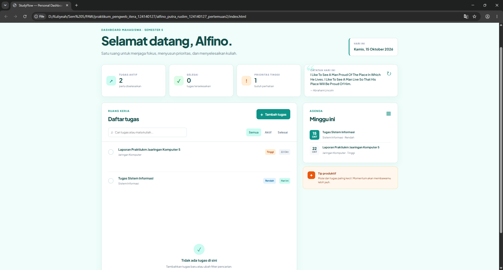
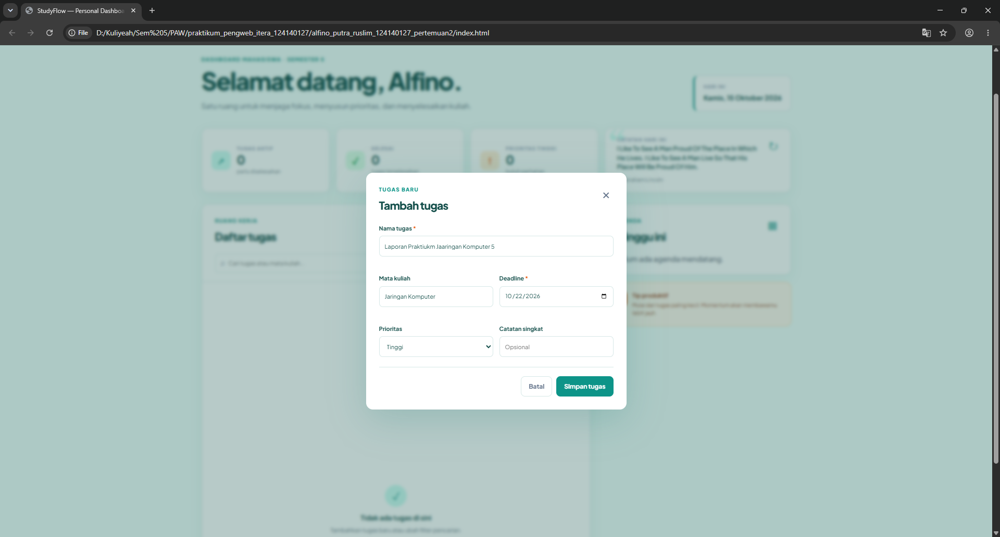
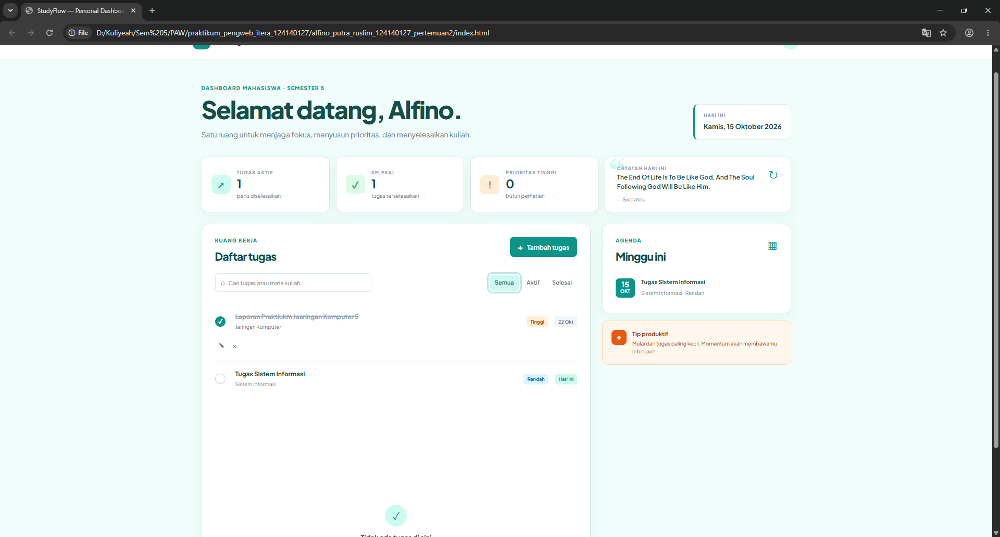

# StudyFlow — Personal Dashboard

Dashboard produktivitas personal untuk membantu mahasiswa mengatur tugas kuliah, deadline, prioritas, dan progres penyelesaian dalam satu ruang kerja.

## Identitas

- **Nama:** Alfino Putra Ruslim
- **NIM:** 124140127
- **Kelas:** RA
- **Pertemuan:** 2 — Personal Dashboard

## Fungsi Aplikasi

StudyFlow dibuat untuk kebutuhan mahasiswa yang ingin memantau tugas kuliah tanpa aplikasi tambahan. Pengguna dapat membuat tugas, menentukan mata kuliah, deadline, prioritas, dan catatan singkat. Tugas bisa dicari, difilter, ditandai selesai, diedit, atau dihapus.

Saat pertama kali dibuka, aplikasi mencoba mengambil lima data tugas awal dari JSONPlaceholder. Dashboard juga menampilkan kutipan motivasi acak dari DummyJSON Quotes melalui `fetch()` dan `async/await`. Setelah itu seluruh data tugas pengguna dikelola di `localStorage`, sehingga tetap tersedia saat halaman di-refresh.

## Struktur Folder

```text
alfino_putra_ruslim_124140127_pertemuan2/
├── index.html
├── style.css
├── script.js
├── README.md
├── screenshots/
│   ├── 01-dashboard.png
│   ├── 02-dialog-tugas.png
│   └── 03-dashboard-interaktif.png
└── modul/
    └── catatan-implementasi.md
```

## Daftar Fitur

- [x] Tambah tugas melalui dialog form.
- [x] Edit judul, mata kuliah, deadline, prioritas, dan catatan tugas.
- [x] Hapus tugas dengan konfirmasi.
- [x] Tandai tugas selesai atau aktif.
- [x] Filter Semua, Aktif, dan Selesai.
- [x] Pencarian berdasarkan judul, mata kuliah, atau catatan.
- [x] Statistik tugas aktif, selesai, dan prioritas tinggi.
- [x] Agenda deadline satu minggu ke depan.
- [x] Penyimpanan tugas menggunakan `localStorage`.
- [x] Inisialisasi tugas dari JSONPlaceholder API.
- [x] Kutipan motivasi dari DummyJSON Quotes API.
- [x] Fallback offline jika API tidak dapat diakses.
- [x] Responsive design dan akses keyboard dasar.

## Fitur ES6+ dan Lokasi Kode

Nomor baris merujuk ke `script.js` versi pengumpulan ini.

| Fitur ES6+ | Implementasi | Lokasi |
|---|---|---|
| `const` dan `let` | Deklarasi konstanta konfigurasi dan state aplikasi | Baris 1–3, 30 |
| Class | `class TaskItem` untuk model data tugas | Baris 5–24 |
| Class | `class DashboardApp` untuk state, DOM, API, dan localStorage | Baris 26–229 |
| Arrow function | Callback DOM, `map`, `filter`, `sort`, dan event listener | Baris 39, 51–63, 78, 121–124 |
| Template literals | Template HTML tugas dan pesan dinamis | Baris 123, 140–148, 163–164 |
| Async/await | Pemanggilan JSONPlaceholder dan DummyJSON | Baris 89–105, 107–116 |
| Destructuring | Parameter constructor, callback array, response quote, dan event | Baris 8, 50, 55, 60, 95, 112, 140 |
| Spread operator | Serialisasi object dan update array immutable | Baris 22, 159, 190, 193, 209 |
| Optional chaining | Pengisian dialog edit dengan `task?.property` | Baris 168–176 |
| `import`/module | Tidak digunakan karena proyek menggunakan file JavaScript langsung agar mudah dijalankan melalui Live Server | — |

## Penyimpanan Data

Data disimpan pada key `studyflow-tasks-v1`. Saat aplikasi dimuat, `loadTasks()` membaca JSON dari `localStorage` lalu mengubah setiap object menjadi instance `TaskItem`. Setiap tambah, edit, checklist, atau hapus memanggil `saveTasks()` sehingga state terbaru terserialisasi kembali menggunakan `JSON.stringify()`.

## API Publik yang Digunakan

- **JSONPlaceholder:** `https://jsonplaceholder.typicode.com/todos?_limit=5` untuk data tugas awal.
- **DummyJSON Quotes:** `https://dummyjson.com/quotes/random` untuk kutipan motivasi.

Keduanya gratis dan tidak memerlukan API key. Jika koneksi gagal, aplikasi tetap berjalan melalui fallback lokal dan tugas masih dapat dikelola secara offline.

## Cara Menjalankan

1. Buka folder `alfino_putra_ruslim_124140127_pertemuan2` di VS Code.
2. Jalankan `index.html` menggunakan Live Server.
3. Izinkan koneksi internet saat pertama kali membuka halaman agar data API dapat diambil.
4. Klik **Tambah tugas**, isi form, lalu simpan.
5. Uji fitur edit, hapus, filter, pencarian, checklist, dan refresh halaman.

## Screenshot Antarmuka

Screenshot di bawah ini diambil dari hasil aplikasi dan disalin ke folder `screenshots/` agar dapat ditampilkan langsung pada repository GitHub.

### 1. Dashboard utama

Menampilkan statistik tugas, daftar tugas, agenda deadline, dan kutipan motivasi.



### 2. Dialog tambah atau edit tugas

Menampilkan form untuk memasukkan judul tugas, mata kuliah, deadline, prioritas, dan catatan.



### 3. Dashboard setelah interaksi

Menampilkan perubahan status tugas, filter, statistik, dan data tugas setelah pengguna berinteraksi.



## Catatan Pengumpulan

Repository GitHub menggunakan format `pemrograman_web_itera_124140127` dan folder tugas ini menggunakan format `alfino_putra_ruslim_124140127_pertemuan2`.
