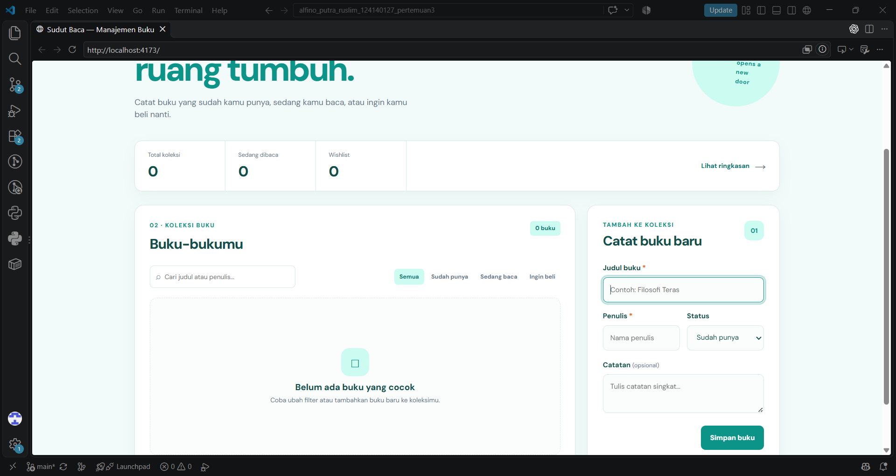
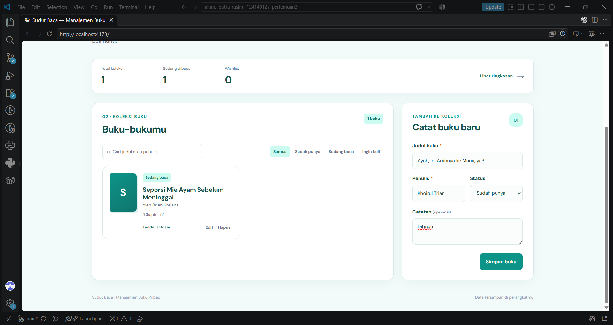
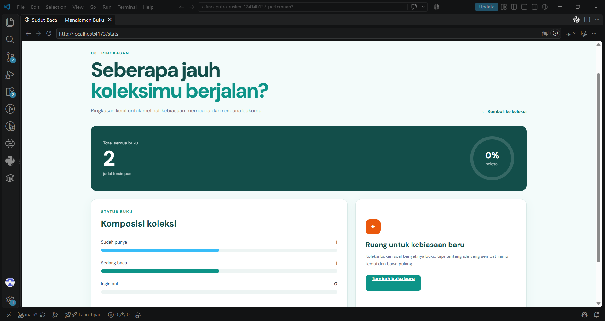
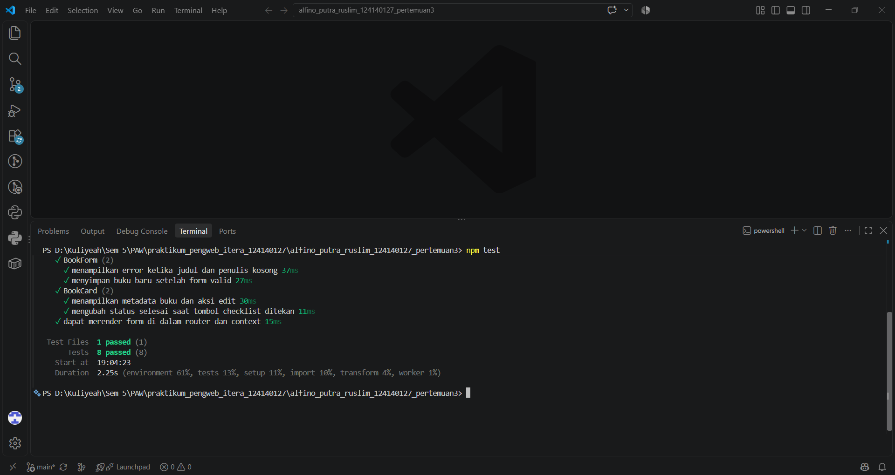

# Sudut Baca — Aplikasi Manajemen Buku Pribadi

## Identitas

- **Nama:** Alfino Putra Ruslim
- **NIM:** 124140127
- **Kelas:** RA
- **Pertemuan:** 3 — React

## Deskripsi Aplikasi

Sudut Baca adalah aplikasi sederhana untuk mencatat koleksi buku pribadi. Saya membuat aplikasi ini karena daftar buku yang ingin dibaca biasanya mudah lupa atau tercecer kalau hanya dicatat di notes. Melalui aplikasi ini, buku bisa dikelompokkan berdasarkan statusnya, yaitu sudah punya, sedang dibaca, atau ingin dibeli.

Selain mencatat buku, pengguna juga bisa mencari buku berdasarkan judul atau penulis, mengedit data, menghapus buku, dan menandai buku yang sudah selesai dibaca. Data buku disimpan di browser menggunakan `localStorage`, jadi data tidak hilang ketika halaman di-refresh.

## Fitur Aplikasi

- Menambahkan buku baru dengan judul, penulis, status, dan catatan.
- Mengedit data buku yang sudah tersimpan.
- Menghapus buku dengan konfirmasi.
- Menandai buku sebagai selesai dibaca.
- Filter buku berdasarkan status.
- Pencarian berdasarkan judul atau nama penulis.
- Halaman statistik koleksi pada route `/stats`.
- Penyimpanan data otomatis menggunakan `localStorage`.
- Validasi form untuk judul dan penulis yang wajib diisi.
- Feedback error visual ketika input masih kosong.
- Tampilan responsif untuk desktop dan mobile.

## Teknologi yang Digunakan

- React dengan functional components dan Hooks.
- Vite untuk menjalankan project dan membuat build.
- React Router untuk navigasi halaman Koleksi dan Statistik.
- Context API untuk mengatur state buku.
- PropTypes untuk mengecek props pada komponen.
- Vitest dan React Testing Library untuk unit testing.
- CSS biasa untuk styling tampilan.

## Struktur Folder Utama

```text
alfino_putra_ruslim_124140127_pertemuan3/
├── index.html
├── package.json
├── vite.config.js
├── screenshots/
│   ├── 01-koleksi-buku.png
│   ├── 02-form-validasi.png
│   ├── 03-halaman-statistik.png
│   └── testing-result.png
└── src/
    ├── App.jsx
    ├── App.css
    ├── index.css
    ├── components/
    │   ├── BookCard/
    │   ├── BookFilter/
    │   ├── BookForm/
    │   └── BookList/
    ├── context/
    │   ├── BookContext.jsx
    │   └── bookConstants.js
    ├── hooks/
    │   ├── useBookStats.js
    │   └── useLocalStorage.js
    ├── pages/
    │   ├── Home/
    │   └── Stats/
    └── test/
        ├── app.test.jsx
        └── setup.js
```

## Instalasi dan Cara Menjalankan

Pastikan Node.js dan npm sudah terpasang. Buka folder project menggunakan VS Code, kemudian buka terminal PowerShell di dalam VS Code.

Masuk ke folder project jika terminal masih berada di folder repository utama:

```powershell
cd .\alfino_putra_ruslim_124140127_pertemuan3
```

Install dependency:

```powershell
npm install
```

Jalankan aplikasi dalam mode development:

```powershell
npm run dev
```

Setelah itu buka alamat yang muncul di terminal, biasanya:

```text
http://localhost:5173/
```

Untuk menghentikan server, tekan `Ctrl + C`.

Perintah lain yang bisa digunakan:

```powershell
npm test          # menjalankan unit test
npm run lint      # mengecek masalah lint
npm run build     # membuat build production
npm run preview   # melihat hasil build production
```

## Penjelasan Fitur React yang Digunakan

### Functional Components dan Hooks

Komponen aplikasi dibuat menggunakan function component. `useState` digunakan pada `BookForm` untuk menyimpan nilai input, mode edit, serta pesan error. `useEffect` digunakan untuk mengisi ulang data form ketika pengguna memilih buku yang ingin diedit.

### Context API

State buku dikelola pada `BookContext.jsx`. Di dalamnya terdapat fungsi:

- `addBook()` untuk menambah buku.
- `updateBook()` untuk mengubah data buku.
- `removeBook()` untuk menghapus buku.
- `toggleFinished()` untuk mengubah status selesai dibaca.

Dengan Context API, komponen seperti `BookForm` dan `BookCard` bisa mengakses state tanpa harus menerima semua data melalui props dari parent.

### Custom Hooks

Ada dua custom hook yang digunakan:

1. `useLocalStorage.js` — menyimpan dan membaca data buku dalam format JSON dari `localStorage`.
2. `useBookStats.js` — menghitung total buku, jumlah buku berdasarkan status, jumlah buku selesai, dan persentase progres membaca.

### React Router

Navigasi dibuat menggunakan React Router:

- `/` menampilkan halaman koleksi buku.
- `/stats` menampilkan statistik koleksi.

Navigasi dilakukan memakai `NavLink` dan `Link`.

### Komponen Reusable

Komponen dibagi berdasarkan tanggung jawabnya supaya lebih mudah dikelola:

- `BookForm` untuk input dan edit buku.
- `BookFilter` untuk pencarian dan filter status.
- `BookList` untuk menampilkan daftar buku.
- `BookCard` untuk menampilkan satu item buku.

Semua komponen yang menerima props sudah dilengkapi `PropTypes`.

### Validasi Form

Judul buku dan nama penulis wajib diisi. Jika pengguna menekan tombol simpan ketika salah satu input kosong, aplikasi tidak menyimpan data dan menampilkan pesan error di bawah input yang bermasalah.

## Screenshot Antarmuka

### 1. Halaman Koleksi Buku

Halaman utama berisi form tambah buku, statistik singkat, pencarian, filter, dan daftar koleksi.



### 2. Validasi Form

Screenshot berikut menunjukkan feedback error ketika judul atau penulis belum diisi.



### 3. Halaman Statistik

Halaman statistik menampilkan jumlah buku dan perbandingan status koleksi.



## Testing

Testing dilakukan menggunakan Vitest dan React Testing Library. Total ada **8 test yang berhasil dijalankan**:

1. Menghitung statistik buku menggunakan `useBookStats`.
2. Menguji callback pencarian pada `BookFilter`.
3. Menguji callback filter status pada `BookFilter`.
4. Memastikan error muncul ketika judul dan penulis kosong.
5. Memastikan buku valid tersimpan ke `localStorage`.
6. Memastikan data buku dan tombol edit tampil di `BookCard`.
7. Memastikan status buku dapat diubah menjadi selesai.
8. Memastikan form dapat dirender bersama Router dan Context API.

Perintah yang digunakan:

```powershell
npm test
```

Hasil testing:

```text
Test Files  1 passed (1)
Tests       8 passed (8)
```



## Build Production

Build production sudah diuji menggunakan perintah:

```powershell
npm run build
```

Hasil build berhasil dibuat oleh Vite tanpa error. Folder `dist/` akan dibuat setelah perintah tersebut selesai.
