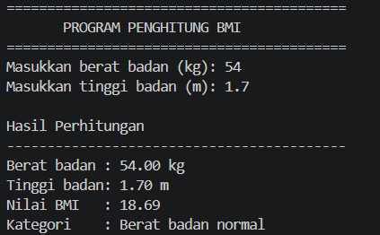
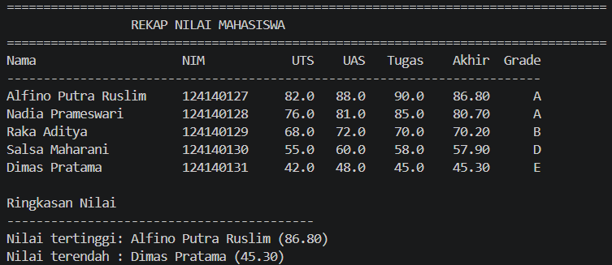
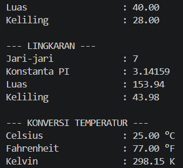

# Tugas Dasar Pemrograman Python — Pertemuan 4

## Identitas

- **Nama:** Alfino Putra Ruslim
- **NIM:** 124140127
- **Kelas:** RA

## Deskripsi Singkat

Folder ini berisi tiga tugas dasar Python. Tugas pertama menghitung BMI dari berat dan tinggi badan. Tugas kedua mengolah data nilai lima mahasiswa menggunakan list dan dictionary. Tugas ketiga menunjukkan cara membuat modul Python sendiri, lalu memanggil fungsi geometri dan konversi suhu dari file `main.py`.

Semua program dibuat dengan fungsi yang memiliki docstring, percabangan, perulangan, f-string, dan penamaan `snake_case`. Program tidak membutuhkan library tambahan.

## Struktur Folder

```text
alfino_putra_ruslim_124140127_pertemuan4/
├── .gitignore
├── README.md
├── tugas1_bmi.py
├── tugas2_nilai_mahasiswa.py
├── math_operations.py
├── main.py
└── screenshots/
    ├── soal1-bmi.png
    ├── soal2-nilai-mahasiswa.png
    └── soal3-modul-matematika.png
```

Folder `venv/`, `.venv/`, `__pycache__/`, dan file bytecode Python sudah dimasukkan ke `.gitignore` sehingga tidak ikut diunggah ke repository.

## Penjelasan Program

### 1. `tugas1_bmi.py`

Program meminta input berat badan dalam kilogram dan tinggi badan dalam meter. Fungsi `hitung_bmi()` menghitung BMI dengan rumus `berat / (tinggi * tinggi)`. Setelah itu fungsi `tentukan_kategori_bmi()` memakai `if-elif-else` untuk menampilkan empat kategori: berat badan kurang, normal, berlebih, atau obesitas. Input juga dicek supaya hanya menerima angka positif.

### 2. `tugas2_nilai_mahasiswa.py`

Program memiliki list berisi lima dictionary mahasiswa. Setiap data memiliki nama, NIM, nilai UTS, UAS, dan tugas. Nilai akhir dihitung dengan bobot 30% UTS, 40% UAS, dan 30% tugas. Hasilnya diberi grade A sampai E, dicetak dalam tabel, lalu program mencari nilai akhir tertinggi dan terendah.

### 3. `math_operations.py` dan `main.py`

`math_operations.py` berfungsi sebagai modul matematika kustom. Isinya adalah konstanta `PI`, fungsi luas dan keliling persegi, persegi panjang, lingkaran, serta konversi Celsius ke Fahrenheit dan Kelvin.

`main.py` menguji seluruh fungsi tersebut. Di dalamnya digunakan dua cara import, yaitu:

```python
import math_operations
from math_operations import celsius_to_fahrenheit, luas_persegi_panjang
```

## Cara Menjalankan di VS Code

1. Pastikan Python sudah terpasang. Cek dengan perintah:

   ```powershell
   python --version
   ```

2. Buka folder `alfino_putra_ruslim_124140127_pertemuan4` di VS Code.
3. Buka terminal PowerShell melalui menu **Terminal → New Terminal**.
4. Jika terminal masih berada di folder repository utama, masuk ke folder tugas:

   ```powershell
   cd .\alfino_putra_ruslim_124140127_pertemuan4
   ```

5. Jalankan setiap program berikut:

   ```powershell
   python tugas1_bmi.py
   python tugas2_nilai_mahasiswa.py
   python main.py
   ```

   Pada Windows, jika `python` tidak dikenali, bisa mencoba:

   ```powershell
   py tugas1_bmi.py
   py tugas2_nilai_mahasiswa.py
   py main.py
   ```

6. Untuk program BMI, masukkan contoh berat `60` dan tinggi `1.65`. Hasilnya berada di kategori berat badan normal.

## Contoh Output

### Soal 1 — BMI

```text
==========================================
       PROGRAM PENGHITUNG BMI
==========================================
Masukkan berat badan (kg): 60
Masukkan tinggi badan (m): 1.65

Hasil Perhitungan
------------------------------------------
Berat badan : 60.00 kg
Tinggi badan: 1.65 m
Nilai BMI   : 22.04
Kategori    : Berat badan normal
```

### Soal 2 — Nilai Mahasiswa

Program mencetak tabel berisi nama, NIM, nilai UTS, UAS, tugas, nilai akhir, dan grade. Program juga menampilkan mahasiswa dengan nilai akhir paling tinggi dan paling rendah.

### Soal 3 — Modul Matematika

Program mencetak hasil luas dan keliling persegi, persegi panjang, dan lingkaran, kemudian menampilkan hasil konversi 25°C ke Fahrenheit dan Kelvin.

## Screenshot Bukti Eksekusi

Screenshot terminal perlu diambil setelah program dijalankan di VS Code. Simpan dengan nama berikut di folder `screenshots/`:

1. `soal1-bmi.png` — hasil menjalankan `python tugas1_bmi.py`.
2. `soal2-nilai-mahasiswa.png` — tabel nilai mahasiswa dan ringkasan nilai tertinggi/terendah.
3. `soal3-modul-matematika.png` — hasil menjalankan `python main.py`.

Contoh cara menambahkannya ke README setelah screenshot tersedia:

```markdown



```

## Catatan PEP 8

- Indentasi menggunakan 4 spasi.
- Nama fungsi dan variabel menggunakan `snake_case`.
- Setiap fungsi memiliki docstring yang menjelaskan parameter dan nilai kembaliannya.
- Kode dipisah menjadi beberapa fungsi supaya alurnya lebih mudah dibaca dan diuji.
