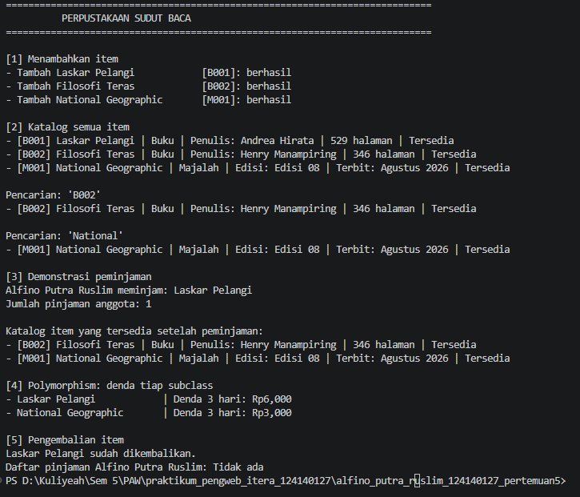

# Sistem Manajemen Perpustakaan Sederhana

## Identitas Mahasiswa

- **Nama:** Alfino Putra Ruslim
- **NIM:** 124140127
- **Kelas:** RA
- **Pertemuan:** 5 — Python OOP

## Deskripsi Program

Program ini adalah sistem perpustakaan sederhana yang saya buat untuk mempraktikkan konsep OOP di Python. Alurnya dimulai dari menambahkan beberapa buku dan majalah ke katalog, menampilkan daftar item, mencari item berdasarkan ID atau judul, lalu mencoba proses peminjaman dan pengembalian.

Class saya pisahkan ke beberapa file supaya programnya tidak terlalu panjang dalam satu file. `LibraryItem` dipakai sebagai class dasar abstrak, sedangkan `Book` dan `Magazine` menjadi turunannya dengan detail serta aturan denda yang berbeda.

## Struktur Folder

```text
alfino_putra_ruslim_124140127_pertemuan5/
├── .gitignore
├── README.md
├── screenshots/
│   └── output-perpustakaan.png
└── tugas_perpustakaan/
    ├── library_item.py
    ├── member.py
    ├── library.py
    └── main.py
```

## Penerapan Empat Pilar OOP

### 1. Class dan Object

Class yang digunakan adalah `LibraryItem`, `Book`, `Magazine`, `Library`, dan `Member`. Class tersebut menjadi blueprint untuk object yang dibuat di `main.py`, seperti `buku_1`, `buku_2`, dan `majalah_1`.

### 2. Inheritance

`Book` dan `Magazine` mewarisi `LibraryItem` dengan sintaks:

```python
class Book(LibraryItem):
class Magazine(LibraryItem):
```

Kedua subclass tetap mendapatkan atribut dan method dasar dari parent class, tetapi masing-masing menambahkan data yang sesuai, seperti penulis untuk buku dan edisi untuk majalah.

### 3. Encapsulation

Beberapa atribut internal menggunakan access modifier protected, contohnya `_id_item`, `_judul`, dan `_is_dipinjam`. Class `Library` menyimpan koleksi dalam atribut private `__koleksi`, sedangkan `Member` menyimpan daftar pinjaman pada `__koleksi_pinjaman`.

Data penting tidak diubah langsung dari luar. Akses status item dilakukan melalui property `is_dipinjam`, `id_item`, dan `judul`. Property `jumlah_pinjaman` juga digunakan untuk membaca jumlah buku yang sedang dipinjam anggota.

### 4. Polymorphism

`Book` dan `Magazine` sama-sama memiliki method `get_detail()` dan `hitung_denda()`, tetapi implementasinya berbeda. Buku memiliki denda Rp2.000 per hari, sedangkan majalah memiliki denda Rp1.000 per hari.

Di `main.py`, kedua object diproses dalam satu perulangan:

```python
for item in (buku_1, majalah_1):
    print(item.hitung_denda(3))
```

Pemanggilan method yang sama menghasilkan denda sesuai jenis object masing-masing. Ini merupakan contoh polymorphism.

### 5. Abstract Class

`LibraryItem` mewarisi `ABC` dan memiliki abstract method `get_detail()` serta `hitung_denda()`. Karena itu, subclass wajib mengimplementasikan kedua method tersebut sebelum bisa dibuat menjadi object.

## Penjelasan File

- **`tugas_perpustakaan/library_item.py`** berisi `LibraryItem`, `Book`, dan `Magazine`. File ini menerapkan abstract class, inheritance, property, dan polymorphism.
- **`tugas_perpustakaan/member.py`** berisi class `Member` untuk menyimpan data anggota dan daftar pinjaman secara private.
- **`tugas_perpustakaan/library.py`** berisi class `Library` dengan koleksi private `__koleksi`. File ini menangani tambah item, katalog, pencarian, peminjaman, dan pengembalian.
- **`tugas_perpustakaan/main.py`** berisi contoh penggunaan semua class dan menampilkan hasilnya di terminal.

## Cara Menjalankan Program

Pastikan Python sudah terpasang. Cek versinya melalui terminal PowerShell VS Code:

```powershell
python --version
```

Masuk ke folder tugas dari root repository:

```powershell
cd .\alfino_putra_ruslim_124140127_pertemuan5\tugas_perpustakaan
```

Jalankan program utama:

```powershell
python main.py
```

Jika perintah `python` tidak dikenali di Windows, gunakan:

```powershell
py main.py
```

Program akan menampilkan proses berikut:

1. Menambahkan dua buku dan satu majalah.
2. Menampilkan seluruh katalog.
3. Mencari item berdasarkan ID dan potongan judul.
4. Meminjam salah satu buku.
5. Menampilkan katalog yang masih tersedia.
6. Menghitung denda dengan method polymorphic.
7. Mengembalikan buku dan menampilkan daftar pinjaman anggota.

## Contoh Output

```text
[1] Menambahkan item
- Tambah Laskar Pelangi           [B001]: berhasil
- Tambah Filosofi Teras          [B002]: berhasil
- Tambah National Geographic     [M001]: berhasil

[2] Katalog semua item
- [B001] Laskar Pelangi | Buku | ... | Tersedia
- [B002] Filosofi Teras | Buku | ... | Tersedia
- [M001] National Geographic | Majalah | ... | Tersedia

[3] Demonstrasi peminjaman
Alfino Putra Ruslim meminjam: Laskar Pelangi
Jumlah pinjaman anggota: 1

[4] Polymorphism: denda tiap subclass
- Laskar Pelangi            | Denda 3 hari: Rp6,000
- National Geographic      | Denda 3 hari: Rp3,000
```

## Screenshot Output

Screenshot berikut adalah hasil menjalankan `python main.py` di terminal PowerShell. Di dalamnya terlihat proses penambahan item, katalog, pencarian, peminjaman, perubahan item yang tersedia, perhitungan denda, dan pengembalian buku.



## Catatan

Program ini tidak menggunakan library eksternal. Folder `venv/`, `.venv/`, `__pycache__/`, dan file bytecode Python sudah diabaikan melalui `.gitignore`.
